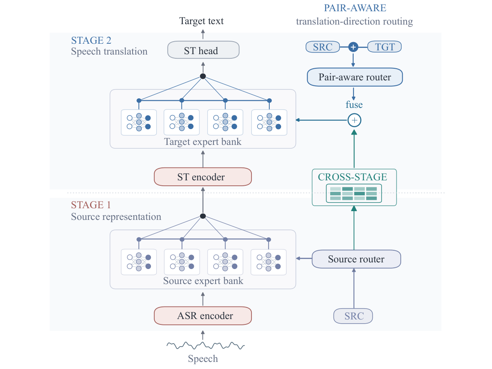
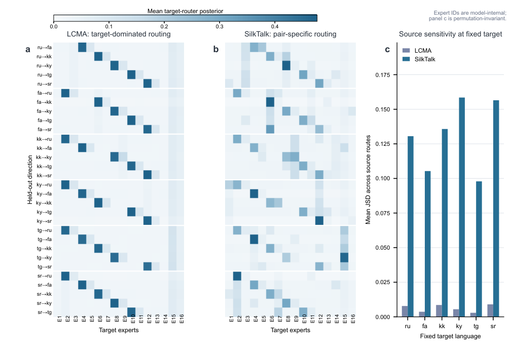
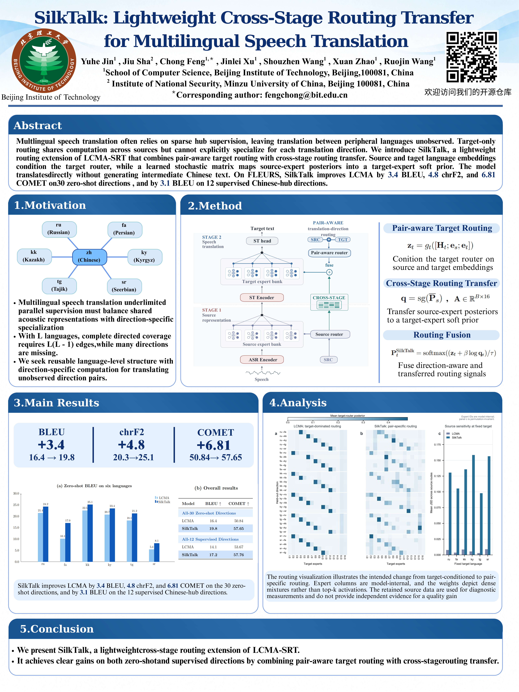

# SilkTalk

### Lightweight Cross-Stage Routing Transfer for Multilingual Speech Translation

**Accepted at CCMT 2026**

Yuhe Jin, Jiu Sha, Chong Feng, Jinlei Xu, Shouzhen Wang, Xuan Zhao, Ruojin Wang 
Beijing Institute of Technology · Minzu University of China

[Poster (PDF)](assets/silktalk-ccmt2026-poster.pdf) · [Method figure (PDF)](assets/method.pdf) · [Routing analysis (PDF)](assets/zero-shot-routing.pdf)

> This repository currently hosts the project overview, poster, and figures. Code and reproduction instructions will be released later.

## Overview

Multilingual speech translation often relies on sparse hub supervision, leaving translation between peripheral languages unobserved. **SilkTalk** extends LCMA-SRT with pair-aware target routing and cross-stage routing transfer to support direction-specific computation in this setting. Translation is direct, without generating intermediate Chinese text.

## Method

- **Pair-aware target routing:** source and target language embeddings jointly condition the target router.
- **Cross-stage routing transfer:** a learned stochastic matrix maps source-expert posteriors to a soft prior over target experts.
- **Routing fusion:** combines the direction-aware routing signal with the transferred source routing prior.

## Main results

Results reported in the accompanying poster on **FLEURS**, comparing SilkTalk with LCMA:

| Metric | LCMA | SilkTalk | Gain |
| :--- | ---: | ---: | ---: |
| BLEU | 16.4 | **19.8** | +3.4 |
| chrF2 | 20.3 | **25.1** | +4.8 |
| COMET | 50.84 | **57.65** | +6.81 |

These results cover **30 zero-shot directions** among Russian (`ru`), Persian (`fa`), Kazakh (`kk`), Kyrgyz (`ky`), Tajik (`tg`), and Serbian (`sr`). On **12 supervised Chinese-hub directions**, the poster reports a **+3.1 BLEU** improvement.

## Routing analysis

The visualization compares LCMA's target-dominated routing with SilkTalk's pair-specific routing, including source sensitivity at a fixed target language. Expert IDs are model-internal; expert columns should not be interpreted as aligned across models. The weights represent dense mixtures, not top-k activations. These routing diagnostics do not independently establish translation-quality gains.

## Poster

## Release status

- [x] Project overview and reported results
- [x] Poster and original PDF figures
- [ ] Training and inference code
- [ ] Environment setup and reproduction instructions

## Contact

For questions about this work, please open a GitHub issue or contact the corresponding author, Chong Feng, at [fengchong@bit.edu.cn](mailto:fengchong@bit.edu.cn).
